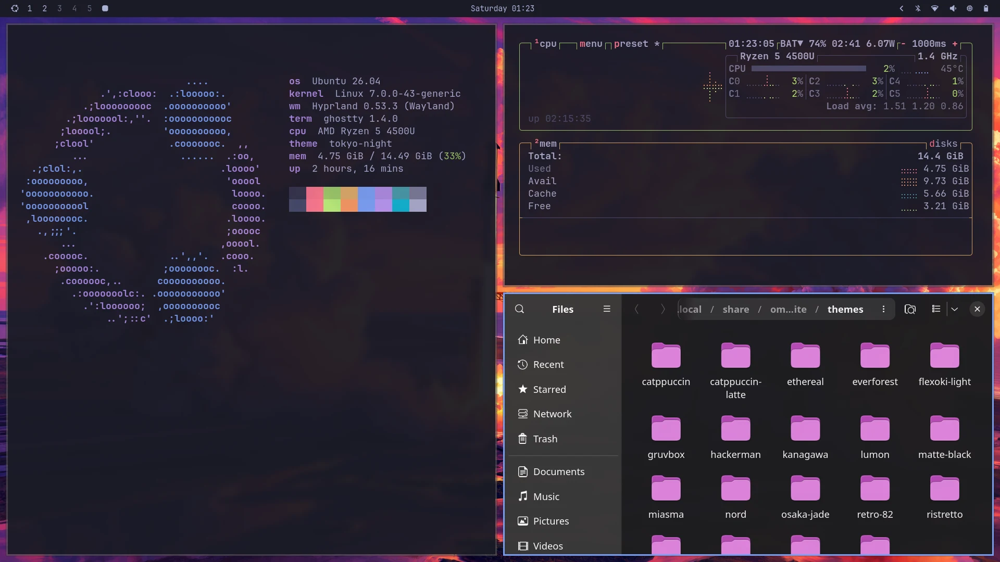
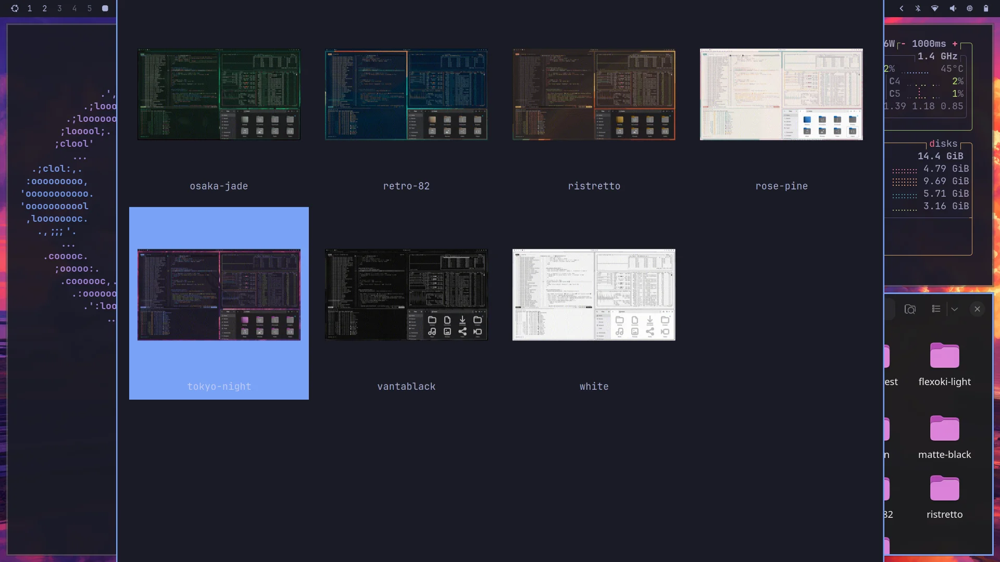
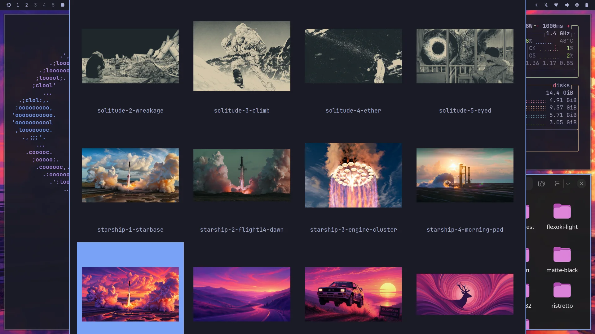

# ubuntu-omarchy-kit

An [Omarchy](https://github.com/basecamp/omarchy)-style Hyprland desktop for **Ubuntu**, installed **next to GNOME**. It's a separate session on the login screen; GNOME stays exactly as it was.

It's built to be set up by an AI coding agent in one pass: [`AGENTS.md`](AGENTS.md) is a playbook with the procedure and every pitfall hit while building it. You can also run the installer yourself.

> Unofficial. Not affiliated with Omarchy or Basecamp. The layout, keybindings and themes are adapted from Omarchy v3.8.4 (MIT).



## What you get

- Hyprland tiling with Omarchy's look, gaps, animations and keybindings
- Waybar top bar, mako notifications, hyprlock lock screen, swayosd volume/brightness pop-ups
- **19 themes** that recolor the borders, bar, terminals (Ghostty and Ptyxis), launcher, notifications, lock screen and folder icons. They come with a **live-preview theme picker**: highlight a theme and it applies; Esc reverts.
- A **live-preview wallpaper picker** with thumbnails, covering the theme wallpapers and your own images in `~/Pictures`
- Things that work as in GNOME: GNOME Keyring logins in Chrome/Electron apps, dark Qt dialogs, Bluetooth (Blueman), brightness keys without root, your GNOME display scale, keyboard layout and touchpad settings

## Screenshots

**One switch recolors everything**: window borders, bar, terminals, launcher, notifications, lock screen and folder icons.


<table>
  <tr>
    <td width="50%"></td>
    <td width="50%"></td>
  </tr>
  <tr>
    <td align="center"><b>Theme picker</b> (Super + Shift + Ctrl + Space). Highlighting a theme applies it live.</td>
    <td align="center"><b>Wallpaper picker</b> (Super + Ctrl + Space). Theme wallpapers plus your own <code>~/Pictures</code>.</td>
  </tr>
</table>

## Requirements

- Ubuntu **26.04** or newer (Hyprland 0.53 from the official repositories)
- Tested on AMD graphics; Intel should work; NVIDIA needs extra steps (see AGENTS.md)

## Use it with an agent

```sh
git clone https://github.com/shahwaizse/ubuntu-omarchy-kit
cd ubuntu-omarchy-kit
```

Then tell your agent: *"Read AGENTS.md and set this up for me."*

## Or install it yourself

```sh
./install.sh --check     # preflight, changes nothing
./install.sh             # asks for your password to install packages
./verify.sh              # every check should pass
```

Log out, click the gear on the login screen, pick **Hyprland** (not "uwsm-managed"), and press **Super + K** for every shortcut. Inside the session, `./verify.sh --live` checks everything is running.

## Keys to start with

| Keys | Action |
|---|---|
| Super + Space | Apps |
| Super + Enter | Terminal |
| Super + W | Close window |
| Super + 1…0 | Workspaces (Shift to move a window) |
| Super + Shift + Ctrl + Space | Theme picker |
| Super + Ctrl + Space | Wallpaper picker |
| Super + Escape | Lock / suspend / log out / reboot / shut down |
| Super + K | All shortcuts |

## Undo

`./uninstall.sh` removes the kit's files, restores anything it backed up and your original GNOME icon/terminal settings, and turns Ubuntu's session services back on. Packages stay installed; it prints the `apt remove` command.

## License

MIT — see [LICENSE](LICENSE). Includes configuration adapted from Omarchy © David Heinemeier Hansson. Themes and wallpapers are downloaded from the Omarchy repository at install time, not redistributed here.
